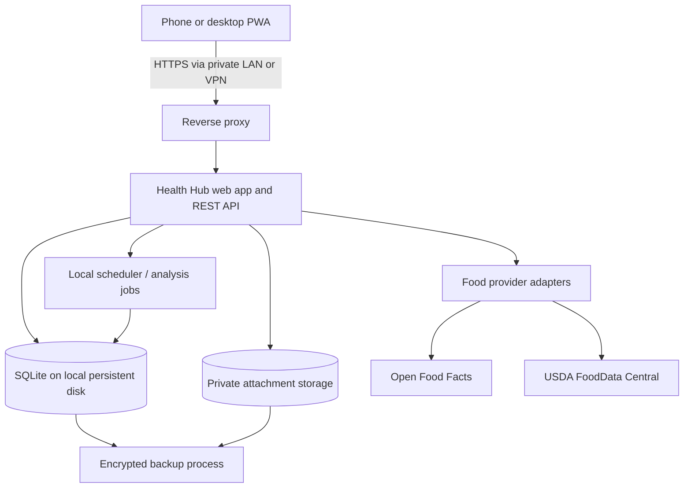

# Personal Health Hub — Software Requirements Specification

**Revision:** 1.0 · 2026-11-25  
**Status:** Proposed architecture and implementation baseline  
**Working name:** Personal Health Hub (placeholder)  
**Deployment:** Self-hosted Docker Compose; mobile-first web application  
**Audience:** Project owner, software developers and coding agents

## 1. Product purpose

Build a private, integrated personal health journal that helps an individual understand how food, digestion, bowel movements, daily wellness, menstrual cycles, measured hormones, sleep, stress, medication and other lifestyle factors change together over time. The application is a longitudinal record and exploratory analysis tool, not a calorie restriction app, diagnostic system, fertility treatment, or contraceptive tool.

The central product principle is **log once, correlate across everything**. A user should never need to record the same meal or symptom in several separate applications. All observations appear on one time-aligned timeline with clear provenance and export capabilities.

### 1.1 Goals and success criteria

- Log a recent meal, bowel movement or symptom in three taps after opening the quick-log menu, excluding optional detail entry. Target median completion under 20 seconds for a typical quick log.
- Record daily wellbeing in under one minute, with optional metrics and no mandatory calorie goals.
- Display a combined day timeline and 7-, 30-, 90-day and custom date ranges.
- Compare food exposure with later symptoms and bowel events while displaying limitations and supporting observations.
- Distinguish measured hormone concentrations, home-test markers and predicted cycle phases.
- Provide usable CSV/JSON data export and a printable clinician summary without external services.
- Keep personal data on the user's infrastructure by default; core logging and reports continue without internet access (local network connection required in v1).

### 1.2 Assumptions and scope

Initial user is an adult tracking their own health. One owner account per installation is sufficient for v1; user ownership is part of every record so additional isolated accounts can be supported later. No pregnancy or fertility intention is assumed. All female-health features can be enabled or hidden independently. No paid API, AI service or wearable is required. English and US customary/metric entry are initial targets. Phone and desktop browsers are the primary clients. Native applications and full offline editing are later phases.

## 2. Open-source reuse strategy

### 2.1 Recommended foundation: fork Allos, after a fit/security gate

Allos already provides a self-hosted health record, timeline, nutrition, symptoms, mood, sleep, medication, laboratory records, documents, export and household profile concepts. It uses Next.js/TypeScript, SQLite, Tailwind and Recharts. Its AGPL-3.0-only license makes it a potential foundation if the project is comfortable with the associated source-sharing requirements.

Before committing, run the upstream Docker stack with synthetic data; review actual schema, permissions, migrations, dependencies, tests, nutrition granularity, temporal event semantics, supported integrations and maintenance status. Verify which target features already exist. Do not assume a README establishes working behavior or security. If the fork gate passes, retain the existing framework and SQLite rather than rewriting or migrating the database unnecessarily. Add features through upstream-compatible domain modules. Prefer contributing generic improvements upstream where feasible.

If Allos fails the gate or an AGPL-based product is undesirable, build independently with a permissively licensed foundation such as Tally (MIT) for food logging and extend it with original health modules. In the independent path, PostgreSQL is an optional alternative to SQLite when multi-user concurrency warrants it. Do not combine restricted code into a permissively licensed distribution without review.

### 2.2 Candidate components and reference projects

| Source                                                                                                        | Published license / terms           | Proposed use                                                 | Integration approach                                                                 |
| ------------------------------------------------------------------------------------------------------------- | ----------------------------------- | ------------------------------------------------------------ | ------------------------------------------------------------------------------------ |
| [Allos](https://github.com/FloorLamp/allos)                                                                   | AGPL-3.0-only                       | Health journal, timeline, records, symptoms, labs, export    | Primary fork candidate                                                               |
| [Tally](https://github.com/GeneArnold/tally)                                                                  | MIT                                 | Food search, portions, saved meals, barcode UI               | Reuse reviewed compatible code or independent fallback                               |
| [NutriTrace](https://github.com/TraceApps/nutritrace)                                                         | AGPL-3.0                            | Self-hosted nutrition and recipe integration                 | Reference or reviewed compatible code                                                |
| [Ovumcy](https://github.com/ovumcy/ovumcy-web)                                                                | AGPL-3.0                            | Cycle calendar, symptom logs, prediction approach            | Reference algorithms and tests; optional API adapter, not a mandatory second service |
| [Health Assistant](https://github.com/health-assistant-io/health-assistant)                                   | Apache-2.0 (repository description) | Lab normalization, clinical document review, FHIR connectors | Review selected compatible components                                                |
| [HealthLog](https://github.com/MBombeck/HealthLog)                                                            | PolyForm Noncommercial 1.0.0        | Health timeline, device integrations, reports                | Feature reference only unless license permission is confirmed; not OSI open source   |
| [Open Food Facts](https://openfoodfacts.github.io/documentation/docs/Product-Opener/api/)                     | ODbL data; separate media terms     | Barcode, ingredients, allergens, packaged nutrition          | Server adapter; attribution and separate source cache                                |
| [USDA FoodData Central](https://fdc.nal.usda.gov/api-guide/)                                                  | Public-domain data                  | Generic foods, nutrient quantities                           | Server adapter with API key or local dataset                                         |
| [HL7 FHIR R4 lab profile](https://hl7.org/fhir/us/core/STU7/StructureDefinition-us-core-observation-lab.html) | Consult implementation guide terms  | Interoperable laboratory data model                          | Standards-based mapping; validate export                                             |

Use existing open-source UI/chart, validation, barcode and testing libraries where practical: React, Tailwind, Recharts, Zod, ZXing, Vitest and Playwright. Check exact package licenses and versions at selection. Prefer standard cryptography and a maintained authentication implementation over custom security code.

**License gate:** Verify licenses at pinned commits, create THIRD_PARTY_NOTICES and an SBOM, document copied code provenance, preserve attribution and comply with AGPL source availability obligations for modified network-served software. Food database/media licensing is separate from software licensing. Do not send health logs to food lookup providers; do not copy proprietary application screens, assets or code. These are engineering recommendations, not a legal opinion or completed license audit.

## 3. Functional requirements

Priority: P0 = initial release; P1 = next release; P2 = optional/later. IDs are intended for issue tracking. Unless specified otherwise all logged records support create, edit, delete, backdate, notes and export. Blank means unknown, not zero or no symptom.

### 3.1 Food and hydration (FOOD)

| ID      | Priority | Requirement                                                                                                                                                                             |
| ------- | -------- | --------------------------------------------------------------------------------------------------------------------------------------------------------------------------------------- |
| FOOD-01 | P0       | Log meals/snacks/drinks with actual consumption time, optional end time, meal category, ingredients and quantities. Allow free-text entries without nutrient data.                      |
| FOOD-02 | P0       | Search a local food catalog, USDA generic foods and Open Food Facts packaged products; barcode scanning and manual entry fallback.                                                      |
| FOOD-03 | P0       | Support recipes, serving sizes, common units, grams/ml, reusable meals, favorites and copy previous meal. Preserve a snapshot of ingredients/nutrients at logging time.                 |
| FOOD-04 | P0       | Track calories, protein, fat, carbohydrates, fiber, sugar, sodium, water, caffeine and alcohol where known; keep optional totals hidden by default. Missing values remain unknown.      |
| FOOD-05 | P0       | Tag ingredients or foods with user-defined potential triggers (e.g. dairy, wheat, onion, garlic, spicy food, high-fat meals). Tags are not diagnoses or guarantees of allergen absence. |
| FOOD-06 | P1       | Support micronutrients, source-specific serving conversions, label photographs and Mealie recipe import if desired.                                                                     |
| FOOD-07 | P1       | Optional before/after meal check-in reminders (configurable delay), linking a symptom event to a meal only when explicitly selected.                                                    |
| FOOD-08 | P2       | Local AI-assisted photo/text parsing with editable draft and mandatory confirmation; display uncertainty, never invent exact nutrition.                                                 |

### 3.2 Symptoms and digestion (SYM)

| ID     | Priority | Requirement                                                                                                                                                                  |
| ------ | -------- | ---------------------------------------------------------------------------------------------------------------------------------------------------------------------------- |
| SYM-01 | P0       | Log a symptom episode with onset time, optional end time, severity 0–10, duration, location, notes and status (ongoing/resolved).                                            |
| SYM-02 | P0       | Presets: bloating, gas, abdominal pain/cramps, nausea, reflux, heartburn, diarrhea, constipation, fatigue, headache, dizziness and skin symptoms. Custom symptoms supported. |
| SYM-03 | P0       | Allow explicit symptom-free check-ins and follow-up severity updates without rewriting earlier observations.                                                                 |
| SYM-04 | P0       | Distinguish digestive symptoms from bowel-event attributes and avoid duplicate counts. Show previous meals, medication and cycle context on the episode view.                |
| SYM-05 | P1       | Body-location selector, configurable frequency/impact fields and suspected trigger tags; record user hypothesis separately from computed findings.                           |

### 3.3 Bowel movements (BM)

| ID    | Priority | Requirement                                                                                                                                      |
| ----- | -------- | ------------------------------------------------------------------------------------------------------------------------------------------------ |
| BM-01 | P0       | Log each bowel movement separately, including timestamp and Bristol Stool Form Scale type 1–7 or unknown.                                        |
| BM-02 | P0       | Record optional color, amount, urgency, pain, straining, incomplete evacuation, mucus and visible blood. Include private notes.                  |
| BM-03 | P0       | Explicit daily no-bowel-movement entry; distinguish it from an unlogged day. Display count/day and days between known events.                    |
| BM-04 | P0       | Charts: frequency, type distribution, consistency over time and symptom overlay. Use original artwork or properly licensed stool-scale graphics. |
| BM-05 | P1       | Optional private photo attachment, disabled by default, without cloud upload, and excluded from reports by default.                              |

### 3.4 Daily wellness and context (WELL)

| ID      | Priority | Requirement                                                                                                                                                                                     |
| ------- | -------- | ----------------------------------------------------------------------------------------------------------------------------------------------------------------------------------------------- |
| WELL-01 | P0       | Morning/evening or on-demand check-ins: overall feeling 1–10, energy 1–10, mood, stress 0–10, fatigue 0–10, focus, notes. Explain scale anchors.                                                |
| WELL-02 | P0       | Sleep start/end, duration, quality, naps and interruptions; hydration, activity/exercise and illness context.                                                                                   |
| WELL-03 | P0       | Daily free-form journal, optional tags and configurable tracking templates.                                                                                                                     |
| WELL-04 | P0       | Custom metrics: boolean, choice, multi-choice, integer/decimal, rating, text, duration or measurement with unit; stable ID, min/max and selectable options. Archive without destroying history. |
| WELL-05 | P1       | Optional contextual factors: travel, shift work, heat, major life events, sexual health (off by default).                                                                                       |
| WELL-06 | P1       | Weight, resting heart rate, HRV, blood pressure, glucose and temperature as opt-in measurements, not default wellness scores.                                                                   |

### 3.5 Female health and menstrual cycle (CYCLE)

| ID       | Priority | Requirement                                                                                                                                                                                                     |
| -------- | -------- | --------------------------------------------------------------------------------------------------------------------------------------------------------------------------------------------------------------- |
| CYCLE-01 | P0       | Record bleeding start/end, spotting, flow, cramps and menstrual symptom notes. Multiple events per day and correction of cycle dates.                                                                           |
| CYCLE-02 | P0       | Log breast tenderness, pelvic pain, hot flashes, night sweats, libido, mood changes, headaches, cervical mucus and discharge where relevant.                                                                    |
| CYCLE-03 | P0       | Calendar view with confirmed periods, cycle day, length, symptom severity and wellness/food/stool overlay. Spotting does not automatically start a new cycle; user can correct inferred boundaries.             |
| CYCLE-04 | P0       | Support irregular cycles, absent periods, hormonal contraception, perimenopause and menopause without forcing a standard 28-day cycle or fertility assumptions. Hide phase estimates where inappropriate.       |
| CYCLE-05 | P1       | Optional BBT, ovulation predictor test results, cervical mucus and user-confirmed ovulation observations. Separate actual measurements from estimates.                                                          |
| CYCLE-06 | P1       | Optional period date estimates with range, algorithm version, input count and uncertainty. Suppress when evidence is insufficient or user context makes prediction unsuitable. No contraceptive recommendation. |
| CYCLE-07 | P2       | Optional pregnancy/postpartum tracking and fertility views, explicitly enabled by the user, with separately reviewed logic.                                                                                     |

### 3.6 Hormones and laboratory data (LAB)

| ID     | Priority | Requirement                                                                                                                                                                                                                              |
| ------ | -------- | ---------------------------------------------------------------------------------------------------------------------------------------------------------------------------------------------------------------------------------------- |
| LAB-01 | P0       | Manual entry of individual test results or panels; numeric, qualitative, censored (e.g. below detection limit), or textual values.                                                                                                       |
| LAB-02 | P0       | Presets: estradiol/E2, progesterone, LH, FSH, total/free testosterone, SHBG, prolactin, DHEA-S, cortisol, TSH, free T4/free T3; support arbitrary biomarkers.                                                                            |
| LAB-03 | P0       | Store specimen type, collection and result dates, collection time, units, reference interval/text, lab/provider, assay/method if known, cycle day/context, fasting status, source and original report.                                   |
| LAB-04 | P0       | Preserve original results and units. Convert only validated equivalent analyte/specimen/unit combinations; no conversion between distinct markers (e.g. serum progesterone and urinary PdG). Use LOINC/UCUM identifiers where available. |
| LAB-05 | P0       | Display laboratory-supplied reference intervals and flags; do not use one universal hormone range. Chart only comparable results; mark changes in lab/method or reproductive context.                                                    |
| LAB-06 | P0       | Record at-home urine hormone measurements/markers (LH, FSH, E3G, PdG) with device, test time and units separately from blood tests. Support manual entry and CSV templates.                                                              |
| LAB-07 | P1       | PDF/image attachments, local OCR or structured extraction into draft values, user review before commit. File upload controls and access authorization required.                                                                          |
| LAB-08 | P2       | FHIR R4 Observation/DiagnosticReport import/export, optional patient portal integration through SMART on FHIR when available; provider-specific mapping and consent.                                                                     |

**Important:** The software cannot measure hormones itself. Cycle estimates and symptoms are not measured hormone concentrations. Device integrations must be verified individually; no assumption of an available Mira or Inito API.

### 3.7 Medication and supplements (MED)

| ID     | Priority | Requirement                                                                                                                         |
| ------ | -------- | ----------------------------------------------------------------------------------------------------------------------------------- |
| MED-01 | P0       | Record medication, supplement, contraception and hormone therapy, dose, unit, route, time, started/stopped dates and as-needed use. |
| MED-02 | P0       | Record actual administration separately from a planned schedule; include missed or skipped dose status and reason if desired.       |
| MED-03 | P1       | Reminders, adherence charts, changes in dose and contextual overlays; do not recommend medication changes.                          |

### 3.8 Timeline, dashboards and reports (VIEW)

| ID      | Priority | Requirement                                                                                                                                                                                              |
| ------- | -------- | -------------------------------------------------------------------------------------------------------------------------------------------------------------------------------------------------------- |
| VIEW-01 | P0       | Unified chronological timeline, day/week/month navigation, filters by event type, search and edit links.                                                                                                 |
| VIEW-02 | P0       | Today's dashboard with quick logs, latest check-in, upcoming user-set reminder, meals, symptoms, bowel events and optional cycle context.                                                                |
| VIEW-03 | P0       | Trends: daily symptom severity, bowel count and Bristol type distribution, mood, sleep, energy, custom metrics and comparable lab series.                                                                |
| VIEW-04 | P0       | CSV per domain and full JSON archive with schema version, original times/units, definitions and provenance. Re-import own archive with deduplication and validation.                                     |
| VIEW-05 | P1       | Printable clinician report with user-selected date range, symptoms, bowel patterns, diet context, menstrual history, labs, medications, graphs and data gaps. PDF via print or secure server generation. |
| VIEW-06 | P1       | Export preview, selectable sections, sensitive-field redaction and separate attachment consent. No public report URLs.                                                                                   |
| VIEW-07 | P1       | User-configurable goals/reminders; default notifications generic ("Time for your check-in"), not explicit reproductive or medical details.                                                               |

## 4. Insights and correlation engine

### 4.1 Requirements

| ID     | Priority | Requirement                                                                                                                                                                                  |
| ------ | -------- | -------------------------------------------------------------------------------------------------------------------------------------------------------------------------------------------- |
| INS-01 | P0       | Show chronological overlay and descriptive counts; filter date range and export underlying events.                                                                                           |
| INS-02 | P1       | Food/ingredient vs later symptom onset and severity, using configurable latency windows (default 0–2, 2–6, 6–24 hours; 24–48 optional).                                                      |
| INS-03 | P1       | Compare bowel frequency and stool type with preceding diet, fluids and medication context; use ordinal/distribution comparisons rather than treating Bristol types as continuous physiology. |
| INS-04 | P1       | Compare symptoms, energy and sleep by confirmed cycle day or inferred phase, labeled separately; no prediction when cycle evidence is insufficient.                                          |
| INS-05 | P1       | Compare wellness with sleep, stress, activity, medication changes and lab collection context. Show missingness and possible confounders.                                                     |
| INS-06 | P2       | Optional adjusted exploratory models, matched days and multiple-comparison correction where inferential statistics are presented. Local AI summaries of computed results only.               |

### 4.2 Proposed deterministic v1.1 method

1. Select one exposure, one outcome, a date range and a lag window. Use event onset/consumption times, not entry creation times.
2. Create exposed and comparable unexposed observation windows from logged days. Require explicit adequate observation coverage (e.g. symptom-free check-in covers a defined interval). Do not count unlogged time as symptom-free or assume an unlogged food was not eaten.
3. Combine overlapping exposure windows and count a symptom onset once per analysis window group. Compare like-duration windows, and disclose overlap with other ingredients/meals. For control windows, use same time-of-day where possible; remove windows with the exposure and washout overlap.
4. Calculate descriptive event rate per window, rate difference, sample counts, observation completeness and median severity among recorded episodes. Keep symptom-free windows separate from severity among episodes. For repeated exposures/day, group dependence by day; do not report naive independence-based p-values.
5. Proposed display gate: at least 5 distinct logged days per comparison group and 14 days of observation overall; user can inspect raw events earlier. These are heuristic UI thresholds, not scientifically validated or statistical guarantees. Display counts, excluded windows, co-exposures and uncertainty; do not present automated diagnosis or elimination diet advice.
6. Show a source-linked explanation: exposure, outcome, lag, numerator/denominator for both groups, number of distinct days, missingness and the underlying records. Allow a user to dismiss or save an association and note possible confounders (cycle, medication, illness, stress, sleep).
7. Cache by profile, query parameters, algorithm version and source revision; invalidate on edits, deletes, imports or tag changes.

**Synthetic insight example:** "Bloating was recorded in 6 of 10 eligible windows after meals tagged dairy, compared with 2 of 12 eligible comparison windows in this dataset. Other meal ingredients and cycle timing may affect this pattern. This is an observed association, not evidence of intolerance." Illustrative data only.

Do not interpolate sparse labs into daily hormone values. Do not imply a cause from a correlation. Do not rank foods as safe/unsafe or generate restrictive diet recommendations. A clinical safety notice should accompany the product, with clinician-reviewed guidance for potentially urgent reported symptoms; no automated triage or reassurance in MVP.

## 5. UX and navigation

### 5.1 Primary pages

| Route          | Screen                                                                                                         |
| -------------- | -------------------------------------------------------------------------------------------------------------- |
| `/`            | Today dashboard                                                                                                |
| `/log`         | Quick log sheet: meal, bowel movement, symptom, check-in, water, medication, period, hormone/lab, custom event |
| `/timeline`    | Time-ordered events, date navigation, type filters                                                             |
| `/food`        | Diary, food catalog, recipes and saved meals                                                                   |
| `/digestion`   | Bowel history, stool scale and digestive episodes                                                              |
| `/wellness`    | Daily check-ins, sleep, activity and journal                                                                   |
| `/cycle`       | Optional period calendar and cycle context                                                                     |
| `/labs`        | Test panels, hormone history and lab charts                                                                    |
| `/medications` | Medication/supplement history                                                                                  |
| `/insights`    | Descriptive trends, exposure comparison and drill-down                                                         |
| `/reports`     | Export and clinician summary                                                                                   |
| `/settings`    | Preferences, metrics, privacy, security, data backup and integrations                                          |

On mobile: bottom navigation Today / Timeline / Log (+) / Insights / More. All forms default to current local time but support backdating. Common fields are visible; advanced details collapse. WCAG 2.2 AA target; keyboard accessible, chart text summaries, screen reader labels, dark/light theme, reduced motion and non-color-only severity encoding. Sensitive UI and calorie/weight tracking may be hidden. No gamification of food restriction or streak punishment.

## 6. Technical architecture

### 6.1 Proposed deployment



Modular monolith initially, not separate containers for every domain. If using the Allos fork, retain its runtime, database, migrations and scheduler conventions. New domain modules: food, digestion, wellness, reproductive, labs, medications, timeline, insights, import/export, notifications, security. The app/API is the single writer and authority for health data. All DB access through server-side authorization and domain services; no direct client DB access. Use a local disk for active SQLite, not SMB/NFS. External storage may hold encrypted backups. Avoid public Internet exposure by default; use LAN or VPN and HTTPS. An offline-capable PWA is P1/P2: explicit opt-in encrypted local queue, no caching medical API responses by default, conflict handling and a device-data purge option. Native HealthKit/Health Connect access requires a compatible native bridge or file import; PWA alone is not sufficient.

### 6.2 Stack selection

| Layer       | Proposed choice                                                                              |
| ----------- | -------------------------------------------------------------------------------------------- |
| App         | Next.js + React + TypeScript (inherit upstream versions if forked)                           |
| UI          | Tailwind CSS, accessible components, Lucide icons                                            |
| Storage     | SQLite/better-sqlite3 and existing migrations; PostgreSQL only if separately justified       |
| Charts      | Recharts, accessible tabular alternatives                                                    |
| Validation  | Zod or existing schema library, server-side enforcement                                      |
| Barcode     | ZXing or compatible browser scanning library                                                 |
| Jobs        | Existing upstream scheduler, idempotent local jobs                                           |
| API         | JSON REST + OpenAPI 3.1; versioned `/api/v1`                                                 |
| Testing     | Vitest and Playwright; synthetic fixtures only                                               |
| Deployment  | Docker Compose, non-root container, persistent volumes, health checks; GitHub Actions for CI |
| Optional AI | Local Ollama-compatible adapter, disabled by default, no autonomous record writes            |

Pin dependency versions after testing; do not blindly replace upstream technologies. Keep secrets out of the repo, images and logs.

## 7. Logical data model

Reuse existing upstream tables where semantically appropriate; names below are conceptual, not final migration DDL. Use foreign keys, transactions, indexes `(profile_id, occurred_at)` and unique external-source IDs scoped to owner and source. UUIDs for new public IDs. Store UTC instants and original timezone/offset plus local calendar date for day-based entries. Date-only entries retain date precision, not invented midnight timestamps. Include created/updated timestamps, revision and data origin. Enforce ownership at each query and attachment fetch. Store decimal measurements without rounding away original values.

| Entity                           | Key fields / relationships                                                                                                                                     |
| -------------------------------- | -------------------------------------------------------------------------------------------------------------------------------------------------------------- |
| User / Profile                   | user_id, profile_id, settings, timezone, optional reproductive context                                                                                         |
| Event                            | event_id, profile_id, kind, start_at, end_at, local_date, time_precision, timezone, notes, source, revision                                                    |
| FoodCatalog                      | food_id, name, barcode, source/source_id, nutrient basis, ingredients, tags, version, attribution                                                              |
| Meal / MealItem                  | event_id, meal_type; food_id, amount, unit, grams if known, historical ingredient/nutrient snapshot                                                            |
| Recipe / RecipeItem              | recipe_id, servings, items, amounts, revision                                                                                                                  |
| SymptomDefinition / Episode      | definition_id, label, scale; event_id, symptom_id, severity, body_location, status, suspected_tags                                                             |
| SymptomReading                   | episode_id, measured_at, severity; retain prior readings                                                                                                       |
| StoolEvent                       | event_id, bristol_type nullable, color, amount, urgency, pain, straining, incomplete, mucus, blood                                                             |
| CheckIn / Coverage               | event_id, mood, overall, energy, stress, fatigue, focus; observed interval, domain, explicit absence                                                           |
| Sleep / Activity / Hydration     | event_id, quantity/duration/quality, units, source                                                                                                             |
| BleedingEvent / CycleObservation | event_id, flow, spotting, symptoms, BBT or OPK values; confirmed cycle boundaries separately                                                                   |
| CycleEstimate                    | profile_id, calculated_at, date range, method_version, evidence, status; derived and replaceable                                                               |
| LabPanel / LabResult             | panel_id, event_id, analyte, LOINC, specimen, collection time, result time, value/comparator, original unit, UCUM, ref range/text, assay, lab, flag, report_id |
| Medication / DoseEvent           | medication_id, name, route, schedule revision; event_id, amount, unit, status, context                                                                         |
| MetricDefinition / MetricReading | metric_id, data_type, allowed_values, bounds, unit, definition version; event_id, typed value                                                                  |
| Attachment                       | id, profile_id, related record, storage key, MIME, size, checksum; access controlled                                                                           |
| ImportJob / ExternalMapping      | source, scoped external id, content hash, imported_at, import status and cursor                                                                                |
| Insight / InsightEvidence        | params, version, source revision, counts, limitations, linked event IDs                                                                                        |
| AuditEvent                       | actor, action, entity id, time, outcome; no sensitive payloads in operational logs                                                                             |

Events and typed detail records are created atomically. Deletion removes or tombstones linked derived data; purge policy documented, including backup retention. Derived cycle estimates and insights are not authoritative measurements. Historical metric definitions and meal snapshots must not change when catalog data is updated.

## 8. API contract outline

All endpoints require an authenticated owner-scoped session; profile context validated server-side. Validate input, paginate, bound date ranges, return structured error codes, use revision/If-Match checks for edits and idempotency keys for retried creates. Implement equivalent existing upstream endpoints rather than duplicate them.

| Method and path                         | Purpose                                           |
| --------------------------------------- | ------------------------------------------------- |
| `GET /api/v1/timeline?from=&to=&types=` | Combined event list, cursor pagination            |
| `POST /api/v1/events`                   | Typed event create; discriminated payload by kind |
| `GET/PATCH/DELETE /api/v1/events/{id}`  | Read, update, delete event                        |
| `GET /api/v1/foods?query=&barcode=`     | Local catalog and optional external lookup        |
| `POST /api/v1/foods`                    | Save custom or provider food snapshot             |
| `GET/POST /api/v1/recipes`              | Manage reusable recipes                           |
| `GET/POST /api/v1/metrics`              | Manage custom metric definitions                  |
| `GET /api/v1/cycles?from=&to=`          | Observed cycles and separately labeled estimates  |
| `GET /api/v1/labs?analyte=&from=&to=`   | Lab records with source and units                 |
| `POST /api/v1/insights/query`           | Bounded analysis request and evidence             |
| `POST /api/v1/imports`                  | Validate and preview import, then explicit commit |
| `POST /api/v1/exports`                  | Generate scoped private export                    |
| `POST /api/v1/attachments`              | Validate and store authenticated attachment       |

Example stool event (synthetic):

```json
{
  "kind": "stool",
  "occurredAt": "2026-11-25T08:15:00-08:00",
  "timezone": "America/Los_Angeles",
  "source": "manual",
  "details": {
    "bristolType": 4,
    "urgency": "none",
    "pain": 0,
    "straining": false,
    "blood": null
  }
}
```

`null` blood means not recorded; false would mean explicitly absent. The API must not silently convert missing information to negative findings.

## 9. Security, privacy and operations

- SEC-01: Authentication required for every health route/API/export/attachment. Owner-only signup after bootstrap. Maintained password hashing (Argon2id or reviewed upstream equivalent), rate limits, revocable secure HttpOnly/SameSite sessions, CSRF protection, passkeys/MFA where available.
- SEC-02: HTTPS; default bind private interface or proxy; database has no public port. VPN preferred for remote access. Cloudflare Tunnel or other third-party proxy is optional and changes the trust boundary; review before enabling. No anonymous data endpoints.
- SEC-03: No analytics/ads/telemetry. Outbound requests limited to explicitly enabled providers; food lookups transmit search terms/barcodes only, never user identifiers or symptom/meal history. Explain search disclosure. Disable external AI and wearables by default; opt-in with clear data scope and revocation.
- SEC-04: Encrypt disks/host storage where appropriate; encrypt backups with separately stored keys. Encrypt stored integration secrets; restrict file permissions. No claim of end-to-end encryption: authorized server processes can read health records. Keep no real medical data in test fixtures, screenshots or Git commits.
- SEC-05: Strict ownership checks even for guessed IDs, file URLs, search and export. No implicit household access. Sensitive sharing requires explicit permission and revocation. Attachments outside public web root; size/type verification, safe filenames and untrusted PDF handling; no active content execution.
- SEC-06: Redact operational logs and errors; restrict audit access. Disable sensitive notification content, third-party fonts/CDNs and remote image fetching by default. Establish retention/purge policy including derived data, caches, exports and backups.
- OPS-01: Compose with app, existing scheduler if required, optional private reverse proxy; local persisted DB/files, encrypted backups. App starts via `docker compose up -d`; health endpoint returns status only. Separate test/staging and production volumes.
- OPS-02: Nightly consistent SQLite backups via supported online backup method or quiesced snapshot; include attachment manifest and configuration. Suggested retention 7 daily / 4 weekly / 3 monthly; separate encrypted copy; test restore before live use and quarterly. Proposed RPO 24h, RTO 2h for home deployment.
- OPS-03: Pin image releases, review migrations and backup before upgrade. Provide restore procedure and downgrade by restoring compatible backup, not blindly rolling back schema. Scan dependency/container vulnerabilities and document fixes.
- OPS-04: Initial sizing assumption 2 vCPU, 4 GB RAM, 20 GB local disk plus backup space; verify against actual workloads, especially OCR/AI. No performance measurements have been conducted.

A private home deployment does not establish HIPAA or other regulatory compliance. Before distributing commercially or using with patients, obtain applicable legal, privacy, clinical safety and security reviews.

## 10. Implementation backlog and release gates

| Milestone                | Work                                                                                                                 | Exit criteria                                                                                          |
| ------------------------ | -------------------------------------------------------------------------------------------------------------------- | ------------------------------------------------------------------------------------------------------ |
| M0 — upstream fit        | Run Allos with synthetic data, audit actual features, license, architecture and security; record gaps and pin commit | Fork/no-fork ADR; reproducible test environment; dependency/license inventory                          |
| M1 — core shell          | Reuse auth, timeline, profile, data ownership, custom metrics, backups; design quick-log UX                          | Secure login, cross-account denial tests, basic CRUD and backup/restore pass                           |
| M2 — food + digestion    | FOOD P0, SYM P0, BM P0; unify meal timestamps and symptom coverage                                                   | Manual/barcode food, stool and symptom logging appear together, edits/export work                      |
| M3 — wellness + hormones | WELL P0, CYCLE P0, LAB P0, MED P0                                                                                    | Cycle context and actual lab records visible with original units and measured vs estimated distinction |
| M4 — MVP polish          | VIEW P0, INS-01, accessibility, export/import, privacy checks                                                        | All P0 acceptance tests pass; no critical known vulnerabilities; restore verified                      |
| M5 — insights            | INS P1, cycle estimates, reports, reminders, optional local attachments                                              | Synthetic correlation tests, missingness handling and report preview verified                          |
| M6 — integrations        | Optional wearable import, FHIR, OCR, offline editing, local AI                                                       | Adapter tests, deduplication, consent and user-review gates; features individually opt-in              |

Avoid starting with AI, wearables, clinical prediction or a complex microservice architecture. Ship usable manual logging first. Milestones are dependency order, not promised time estimates.

## 11. Acceptance tests and definition of done

| Test  | Scenario / expected result                                                                                                                                    |
| ----- | ------------------------------------------------------------------------------------------------------------------------------------------------------------- |
| AT-01 | Meal logged at 12:30; bloating at 14:15; stool at 15:00; all appear in correct timeline order and later edits update analytics.                               |
| AT-02 | Food catalog edited after a meal; old nutrition snapshot stays unchanged; missing nutrients remain missing.                                                   |
| AT-03 | Record two stools in one day; counts and Bristol type distribution are correct. No-event day is distinct from explicitly zero events.                         |
| AT-04 | Symptom-free interval vs unlogged interval: only adequately observed eligible windows enter comparison denominators.                                          |
| AT-05 | Symptom spanning midnight; onset is counted once, local day summaries and DST offsets are accurate. Date-only records do not imply exact times.               |
| AT-06 | Irregular cycles and hormonal contraception; predictions can be disabled; spotting does not silently reset cycle start.                                       |
| AT-07 | Serum progesterone and urinary PdG are displayed separately; invalid conversions blocked; original units and reference text preserved.                        |
| AT-08 | Lab result correction, censored value and unknown unit survive export/reimport without loss.                                                                  |
| AT-09 | Replay import twice, retry create and edit concurrently: no duplicates, stale revisions rejected, no silent overwrite.                                        |
| AT-10 | User A requests user B's events, labs, files, export and insights: all denied with no sensitive disclosure.                                                   |
| AT-11 | Internet unavailable: manual log, local foods, timeline, charts and export still work over LAN; external lookup failure is nonfatal.                          |
| AT-12 | Restore database and attachments from encrypted backup into isolated test instance; record counts, hashes and sample exports match.                           |
| AT-13 | Synthetic overlapping meals and symptom events: no duplicate outcome counts; excluded windows, evidence and limitations shown.                                |
| AT-14 | Notification, logs, export preview and deletion: no unauthorized health disclosure; deleted records absent from derived views; retention behavior documented. |
| AT-15 | Mobile usability, keyboard navigation, text contrast and chart alternatives checked; quick log speed measured with representative tasks.                      |

Definition of done: implementation, automated unit/integration/E2E tests, migration tests, updated OpenAPI/docs, permission checks, accessibility review, no committed secrets, and operator rollback/backup instructions. Clinical language reviewed before public release. All P0 requirements must be covered by tests before claiming MVP completion.

## 12. Repository deliverables

```text
README.md                 # install, use, upgrade, restore
LICENSE                   # selected after license gate
THIRD_PARTY_NOTICES.md
SECURITY.md
CHANGELOG.md
.env.example              # placeholders only
docker-compose.yml
Dockerfile
/docs
  PROGRAM_SPEC.md         # this document
  architecture.md
  decisions/0001-foundation.md
  data-model.md
  openapi.yaml
  privacy.md
  backup-restore.md
  analytics-method.md
/src                      # preserve upstream structure if forked
/tests                    # synthetic fixtures only
```

### First coding-agent task

> Read this specification. Inspect the candidate Allos repository and pinned license. Produce a requirement-by-requirement gap matrix marking existing, partial, missing, or unverified features with code paths and tests. Identify schema/auth/migration risks and reusable components. Write an architecture decision record for fork vs independent implementation. Do not change existing behavior, ingest real health data, connect external services, or implement all features in one pass. After the foundation is accepted, create a small issue backlog for M1–M2 with acceptance tests and implement vertical slices that include persistence, API, mobile UI and tests.

## 13. Decisions and known limitations

- The project name, chosen candidate foundation, license strategy, technology and release priorities are proposed defaults, not user-confirmed decisions.
- Sources reviewed are public project descriptions and documentation as of the revision date. Repositories have not been cloned, executed, security-audited or verified against each requirement. Integration and license details require a pinned-commit review.
- Existing products may already provide some of the proposed modules; the M0 gap matrix should eliminate redundant work.
- Association methods and sample thresholds are exploratory, not clinically validated. No diagnostic or treatment claim is intended.
- This is an implementation specification, not working application code. No repository, health account, or deployment has been modified.
